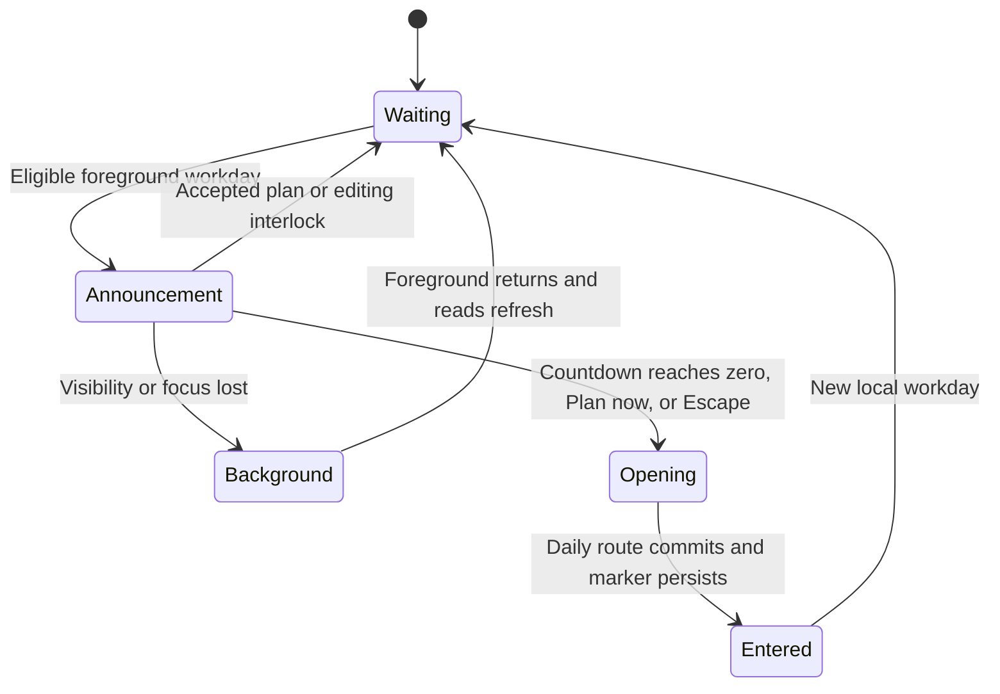

# Daily planning

This is for product designers and engineers changing the daily flow. They should preserve the existing daily planner and its saved stages. Today remains the default home after planning.

Daily planning uses an independent activity layout with a centered workspace. It never mounts the application sidebar, document tabs, or global rails. Desktop Work and Agenda can be shown alone or together without discarding edits. Phones show one at a time with explicit Work and Agenda controls, keeping the other panel mounted and preserving its edits. Its navigation consists of the target date, planning stages, and Today exit. The application sidebar, workspace header, document tabs, and side panels return after leaving the flow. Weekly planning and the morning/evening reviews also use a focused activity with an explicit Today exit.

Planning stages use numbered text navigation with the current stage underlined. They remain clickable. Phone labels shorten to Yesterday, Plan, and Review while the screen title names the full stage. Today and the desktop Panels control use quiet text controls. Filled buttons identify actions such as Review plan and Confirm plan rather than the current stage.

The phone activity canvas has no outer content inset. Navigation and active panels own their content gutters; no generic padded wrapper surrounds a padded editor. Selected work uses compact, unboxed rows instead of a stack of individual cards. Titles and planned minutes remain directly editable, while scheduling and reorder actions stay in the row menu. Existing-task discovery hides work already selected by default, but an explicit search can still find it and marks it In plan. Long titles and metadata must reflow without clipping the row controls. The agenda viewport uses the shared rounded surface; an empty all-day header consumes no space. Timed blocks keep their actual proportional height.

The morning review asks for a decision on each block before Finish review. Evening review shows one revisitable step at a time: unfinished work, reflection, then tomorrow. Switching steps retains unsaved answers. Tomorrow confirmation stays unavailable until earlier required decisions are saved.

Docket automatically opens the daily planner once per eligible local workday. The authenticated application shell shows “It’s time to plan your day.” and “Opening planner in 5 seconds.” Plan now opens the planner immediately. Escape also proceeds immediately. The dialog has no Later, close, skip, or dismissal action. Outside clicks leave it open.

Eligibility uses the scheduling timezone and the outer bounds of today’s non-personal availability windows. The API supplies its existing defaults when preferences are unset. An accepted day suppresses entry even when an adjustment draft exists. A loading or failed read never counts as an unplanned day. A person already in the daily planner continues there.

The countdown runs only while the document is visible and the window has focus. Losing either cancels entry without navigation. Returning reloads eligibility and starts a fresh five-second countdown. An active editor, another dialog, or an authentication transition prevents entry. Confirmation arriving during the countdown cancels it.

Navigation uses `/plan/day?date=YYYY-MM-DD` and the existing controller resumes the saved stage. A browser marker scoped to the user, timezone, and date records the committed destination and prevents repeated entry across reloads and tabs. Unavailable browser storage falls back to an in-memory marker. Automatic entry does not accept a plan or start tracking. The planner keeps its existing exit behavior.

This state machine shows the automatic entry lifecycle. Eligibility and successful reads allow the announcement. Leaving the foreground cancels it. Navigation records entry when the daily route commits.

The standard path is Review yesterday → Plan today → Review plan → Confirmation. A new user with no recent work starts at Plan today. Docket proposes eligible work when it exists, and current tasks remain available in the inline browser. A returning user resumes the saved draft at its last stage. A person who starts late sees the time still available before their chosen finish time. Work already completed or tracked stays visible as recorded work and does not become a new planned session. Tomorrow uses the same flow with tomorrow's date shown throughout.

Plan today keeps selected work, existing tasks, and the agenda on the same screen at desktop width. Existing tasks default to unfinished work assigned to or created by the person across active workspace memberships. Search, responsibility, workspace, and due filters read current tasks directly rather than waiting for search indexing. Pages continue beyond the first fifty results. Each task has a compact plus action with an accessible name and tooltip. The filter icon reveals responsibility, workspace, and due controls. More task actions contains New task and bulk selection; New task opens the normal composer. Work and Agenda keep the same desktop positions during review; phones initially show Agenda during final review and retain Work behind its panel control.

A person can select an empty agenda time range or use Schedule work to choose a task and duration. Existing draft blocks open for editing and support shared move and resize gestures; fixed calendar events open their canonical detail editor with its normal permissions. All-day entries appear directly above the agenda. Busy entries offer a Blocks work checkbox that changes only this private day plan; their source calendar event remains unchanged. The drop-target layer provides placement feedback without intercepting clicks or blocking gestures. A person can leave work under Unscheduled and still confirm. Each row can edit its title and planned minutes directly. Read-only totals and estimates use concise hour/minute formatting; the editable duration field stays minute-based for precise changes. Each block has explicit controls for scheduling, moving, changing duration, pinning, and removing. A task may have two planned sessions, and a block may hold two tasks.

Review plan keeps the agenda and work editable. Athena may add a short qualitative assessment, but an unavailable assistant does not delay confirmation. Unscheduled work names the affected tasks and provides scheduling, date, and removal actions. Start, finish, buffer, and task minutes remain editable. An adjustment shows what changed before Apply. Confirmation has its own screen and offers an explicit Start or Continue action when a task is next today. A tomorrow plan does not offer to start today's timer. Confirming by itself never starts a timer. A plan with no selected work shows a warning and requires explicitly choosing to keep the day without planned work. The accepted screen shows selected work and remaining commitments, retains active tracking context, and offers Adjust plan.

Today uses accepted allocations to show Now and the following work. Recorded time can satisfy the day's planned budget without completing the task. An active session remains current. A missed block offers Done, Still working, and Not started. Done opens exact-time entry so the person can correct what happened; it does not complete the task. The other choices open a remaining-day proposal. Fixed events and pinned blocks stay in place. Applying an accepted adjustment appends a revision, and Undo appends a restoring revision. The original plan and recorded time remain intact as separate facts.

Review day opens a bulk review of today's unfinished work before planning tomorrow. Work already selected for tomorrow stays selected unless the person chooses another destination or Done. Returning after several missed days consolidates unresolved commitments into one review. The review decision applies to older occurrences of the same unresolved task without rewriting accepted snapshots.

Athena can assess the visible plan and suggest missing project work, but no step requires it. Each suggestion has Add and Dismiss actions. Labels name work or actions. Supporting copy states a condition or consequence, and it avoids claims about what the interface is doing on the person's behalf.

Plan today opens with an ordered proposed schedule. Docket places existing commitments first, then suggests eligible work when useful capacity remains. Every suggestion includes a reason. Incomplete dependencies can keep a task visible under Unscheduled. Minute estimates and recorded history inform Planned time; points never become minutes. Start and finish remain editable, and the default buffer reserves 15% of free work time.

Docket adds backlog suggestions only when their remaining work fits. It keeps prior choices when a day becomes full. The agenda retains all-day context and available calendar events without treating them as busy time. The agenda shows the workday range with one control to open Start, Finish, and buffer settings. Settings remain closed until requested, including when no work schedule exists. The disclosure shows the scheduling timezone and missing-schedule condition. All-day context stays visible; a busy all-day entry reduces availability unless the person switches off Blocks work for this plan. Schedule work and Organize day use named icon controls beside the Agenda heading. Apply, Keep current, and Undo appear only when a proposal or reversible change exists.

Organize day explicitly builds a proposed schedule. Manual edits save without automatically opening another proposal. When no timezone preference exists, planning first saves the browser timezone; a saved timezone remains authoritative. The configured workday start stays separate from the current time, and a day that has ended reports that condition without reversing the displayed hours.

Moving a work card changes today's sequence. Moving or resizing a calendar block changes its placement or allocation time. Neither action changes task priority. Changes to future flexible work appear on the agenda before Apply, with Undo afterward. Manual placements, pinned blocks, fixed events, protected time, and recorded work remain intact.

A retained block that extends past an edited finish time names its affected tasks and offers Move or shorten block. Docket never extends the workday silently. Moving an unscheduled task to tomorrow keeps the current day stable until the write succeeds, and prevents confirming or leaving during that write.

Immersive Focus shows the current task description as Markdown, its project, subtasks, and related work using canonical task links. The companion shows the next commitment and other accepted unfinished work when available. On phones, session controls precede the task document so a long description cannot hide the initial Pause or Resume action. Session total names the time accumulated across the record; Today remains the separate date-scoped ledger. Empty descriptions offer a task-detail destination for adding context.

The compact shell keeps its navigation and Agenda launchers disabled in server-rendered HTML until their handlers hydrate. Returning to Today must allow the first enabled Agenda activation to open its pane.
