# Template and repeating-work setup

Reader: A Docket contributor who needs to save reusable starting fields or repeat existing work.

Create a template from Workspace Settings → Templates. Basics holds the template name,
usage note, and sharing. Work holds the fields for the selected work kind and its document.
Review shows the values before Create template saves them. For example, a project template named
Client project can supply a project name, description, status, and health.

Editing opens Work directly. The section tabs let you change metadata or inspect Review before
Save changes. Sharing and work kinds retain the workspace's vocabulary and existing permissions.

Desktop setup fits its content up to the viewport limit. Phones use the full screen. Labeled
name and summary fields precede the starting settings and document. The body owns scrolling;
Back, Continue, and save actions remain visible in the footer.

The following state diagram shows new-template setup.

```mermaid
stateDiagram-v2
    [*] --> Basics
    Basics --> Work: Required name provided
    Work --> Review: Continue
    Review --> Work: Back
    Work --> Basics: Back
    Review --> Saved: Create template succeeds
    Review --> Review: Save fails; draft retained
    Saved --> [*]
```

Use Repeat project from an existing project's actions. Work lists the included tasks and
milestones and offers the existing release modes. Repeat shows cadence, start date, interval,
and ending controls directly. More options exposes the existing advanced recurrence settings. Review shows the work,
release mode, schedule, and supported behavior before Start repeating saves the definition and
schedule. Calendar materialization controls how far ahead Docket maintains generated work. It
does not specify how many days before each occurrence to create it.

Open Manage repeating work from a generated task or project to change its future schedule,
review upcoming occurrences and history, or pause, resume, or end the series. The direct series
route presents the same controls. A future schedule revision retains recorded occurrence history.

Switching sections preserves values. Closing a changed draft requires explicit discard. A failed
save retains the draft and shows a recoverable error. Drafts remain in memory; reloading the
browser does not recover them. This delivery adds no nested work definitions, version publishing,
or template-update comparisons.

Shipped examples include Side project, Client project, Long-term goal, Fundraising campaign, and
Running a business. They are editable template data rather than product types. The same work
fields and sharing permissions apply to individual work and work across companies or nonprofits.
Catalog changes apply only when an empty workspace is seeded; they do not overwrite saved templates.
