# Template and repeating-work setup

Reader: A Docket contributor who needs to save reusable starting fields or repeat existing work.

Create a template from Workspace Settings → Work templates. Basics holds the template name
and usage note. New guided drafts are visible only to you until you explicitly publish them. Work holds the fields for the selected work kind and its document.
Review shows the values before Create template saves them. For example, a project template named
Client project can supply a project name, description, status, and health.

The saved draft opens in its editor. Save draft keeps your next-version edits separate from the
published version. Publish to workspace makes the reviewed body visible to workspace members;
team offerings control where it is suggested. Existing team-only templates remain team-visible
drafts until publication. Personal drafts remain author-only. Publishing a next version preserves
all earlier versions and leaves existing work unchanged.

Select a published template in any work composer. Keep current fields changes only its identity;
Apply starting fields appends the outline, fills empty names, and applies the selected defaults.
Dates remain as authored. A private starting draft is labeled as a draft and uses the kind's blank
base identity. Each work header shows its saved template/version. Change template previews starting
field differences, with every optional change off until selected. Dates and children stay unchanged.
Work lists can filter and group by Template, including archived templates already used by work.

Desktop setup fits its content up to the viewport limit. Phones use the full screen. Labeled
name and summary fields precede the starting settings and document. The body owns scrolling;
Back, Continue, and save actions remain visible in the footer.

The following state diagram shows new-template setup.

```mermaid
stateDiagram-v2
    [*] --> Basics
    Basics --> Work: Required name provided
    Work --> Review: Continue
    Review --> Work: Back
    Work --> Basics: Back
    Review --> Saved: Create template succeeds
    Review --> Review: Save fails; draft retained
    Saved --> [*]
```

Use Repeat project from an existing project's actions. Work lists the included tasks and
milestones and offers the existing release modes. Repeat shows cadence, start date, interval,
and ending controls directly. More options exposes the existing advanced recurrence settings. Review shows the work,
release mode, schedule, and supported behavior before Start repeating saves the definition and
schedule. Calendar materialization controls how far ahead Docket maintains generated work. It
does not specify how many days before each occurrence to create it.

Open Manage repeating work from a generated task or project to change its future schedule,
review upcoming occurrences and history, or pause, resume, or end the series. The direct series
route presents the same controls. A future schedule revision retains recorded occurrence history.

Switching sections preserves values. Closing a changed draft requires explicit discard. A failed
save retains the draft and shows a recoverable error. Unsaved editor changes survive navigation within the signed-in app session. Reloading does not
recover unsaved changes; save a draft before reloading. Account or permission changes clear private
unsaved drafts. Guided dialog dismissal requires explicit discard. Blueprint children and Program
schedule templates follow in separate delivery layers.

Shipped examples include Side project, Client project, Long-term goal, Fundraising campaign, and
Running a business. They are editable template data rather than product types. The same work
fields and sharing permissions apply to individual work and work across companies or nonprofits.
Catalog changes apply only when an empty workspace is seeded; they do not overwrite saved templates.
