# Template and repeating-work setup

Reader: A Docket contributor defining the kinds of work their organization does or repeating existing work.

Open Workspace Settings → Work templates → New template. Purpose establishes the name, existing
work kind and when to use it. Work shapes the sample item: its starting fields and document, included
children, relative dates and responsibility rules. Select a child to refine it without losing the
outline. Review reads back the definition before sharing it. For example, an Event project can
include venue preparation, an optional Vendor booking template and a Dinner day milestone.

Save draft keeps a new definition private and your next-version edits separate from the
published version. Publish to workspace makes the reviewed body visible to workspace members;
team offerings control where it is suggested. Existing team-only templates remain team-visible
drafts until publication. Personal drafts remain author-only. Publishing a next version preserves
all earlier versions and leaves existing work unchanged.

Select a published template in any work composer. Keep current fields changes only its identity;
Apply starting fields appends the outline, fills empty names, and applies the selected defaults.
Dates remain as authored. A private starting draft is labeled as a draft and uses the kind's blank
base identity. Each work header shows its saved template/version. Change template previews starting
field differences, with every optional change off until selected. Creation reviews optional child
work before saving the whole tree together, up to 500 items including the root. Update template
and Change template let you review selected child, date and dependency changes while preserving
authored work. Explicitly edited or cleared dates stay manual.
Work lists can filter and group by Template, including archived templates already used by work.

The editor uses the full page on desktop and phones. Contained sections distinguish the definition,
sample work and child outline. Save state stays visible as you work, and Review makes publication
and its workspace visibility clear. All three sections are directly selectable. Returning to a saved
definition opens Work; switching sections keeps your selected child, input and editing position.
The Work outline separates the starting item, Included work and, for Programs, Recurring work.
Children appear under their parents in the order you arrange them. Collapse Included work to reach
routines without traversing a long child list. On desktop the outline stays available while reading
a long document; on phones Back to outline returns to the selected item.

The following state diagram shows how a definition can be refined and published.

```mermaid
stateDiagram-v2
    [*] --> Purpose: New definition
    [*] --> Work: Reopen saved definition
    Purpose --> Work: Define the work
    Work --> Purpose: Refine purpose
    Work --> Review: Review definition
    Review --> Work: Refine work
    Review --> PrivateDraft: Save draft
    PrivateDraft --> Review: Review saved draft
    Review --> Published: Publish to workspace
    Review --> Review: Save fails; draft retained
    Published --> Work: Refine next version
```

Use Repeat project from an existing project's actions. Work lists the included tasks and
milestones and offers the existing release modes. Repeat shows cadence, start date, interval,
and ending controls directly. More options exposes the existing advanced recurrence settings. Review shows the work,
release mode, schedule, and supported behavior before Start repeating saves the definition and
schedule. Calendar materialization controls how far ahead Docket maintains generated work. It
does not specify how many days before each occurrence to create it.

Open Manage repeating work from a generated task or project to change its future schedule,
review upcoming occurrences and history, or pause, resume, or end the series. The direct series
route presents the same controls. A future schedule revision retains recorded occurrence history.

A Program definition can include routines such as a monthly community dinner. Choose the published
template each routine creates, name the schedule, set the new item's title and repeat pattern, and
choose when it begins relative to Program creation. Responsibility can follow the Program's owner
and team. Specific people, dates and timezone belong to the created Program's schedule.
Creation review shows the first run and any work still needing an assignment or date.
Each Program receives independent schedule copies. Editing and publishing the definition later
leaves existing copies intact. Open Schedules in the Program to adjust future runs, pause or resume,
and review failed runs. Retry keeps the same run and selected template versions without duplicating
work. Missed runs awaiting a decision offer Create work using their original scheduled date.
Ending a schedule preserves its history. Undoing Program creation archives the Program and its
original included work, and ends its unchanged installed routines; independent edits prevent that undo. Work generated by
already accepted runs and their history remain intact.

Switching sections preserves values. Closing a changed draft requires explicit discard. A failed
save retains the draft and shows a recoverable error. Unsaved editor changes survive navigation within the signed-in app session. Reloading does not
recover unsaved changes; save a draft before reloading. Account or permission changes clear private
unsaved drafts. Leaving the authoring page with changed work requires explicit discard.

Shipped examples include Side project, Client project, Long-term goal, Fundraising campaign, and
Running a business. They are editable template data rather than product types. The same work
fields and sharing permissions apply to individual work and work across companies or nonprofits.
Catalog changes apply only when an empty workspace is seeded; they do not overwrite saved templates.
