# Template and repeating-work setup

Reader: A Docket contributor creating reusable work templates or repeating existing work.

Open Work templates in workspace navigation. The compact library lists each definition once with
its purpose, kind and draft/publication state. Choose a definition to continue, Define work to
start your own, or Browse starting points to adapt a gallery example. Settings contains only
Template permissions.

Opening or creating a template replaces workspace navigation with a focused activity and an
explicit way back. Purpose names the template and when to use it. Starting work defines the
initial fields and document for one new item. On wide screens, the document and included-work
outline occupy the main column, with defaults beside them. Phones show the work first and defaults
below it. The inline outline shows names, optionality and relative dates; Edit included work opens
the existing structure editor without losing the document. Review displays the starting document
without a disclosure. Documents and included-work names use 16px MD3 roles. Dates, helper copy
and step labels use 14px roles; headings and control dimensions retain their existing scale.
Included work defines children, relative dates,
responsibility and Program routines. Review explains the resulting structure, publication
prerequisites and workspace visibility before sharing. For example, an Event project can include
venue preparation, a Vendor booking definition and an event-day milestone.

Save draft keeps a new template private. Save changes keeps edits separate from the
published version. Publish to workspace makes the reviewed body visible to workspace members;
team offerings control where it is suggested. Existing team-only templates remain team-visible
drafts until publication. Personal drafts remain author-only. Publishing a next version preserves
all earlier versions and leaves existing work unchanged.

Select a published template in any work composer. Keep current fields changes only its identity;
Apply starting fields appends the outline, fills empty names, and applies the selected defaults.
Dates remain as authored. A private starting draft is labeled as a draft and uses the kind's blank
base identity. Each work header shows its saved template/version. Change template previews starting
field differences, with every optional change off until selected. Creation reviews optional child
work before saving the whole tree together, up to 500 items including the root. Update template
and Change template let you review selected child, date and dependency changes while preserving
authored work. Explicitly edited or cleared dates stay manual.
Work lists can filter and group by Template, including archived templates already used by work.

The editor owns the full window on desktop and phones, without the workspace sidebar, global
navigation or utility rail. New templates use four visible steps, beginning with Purpose. Continue
checks the current step before advancing; completed steps remain available. Back and Continue stay
in the activity footer while its content scrolls. A secondary Save draft action can save valid
changes before Review. Saving the first draft retains creation mode, section, selected child or
routine, focus and editing position. Review offers Save draft before the separate Publish action.
Finish with private draft returns to the library without publishing. Successful publication also
finishes creation.

Opening a saved template from the library uses direct section navigation. It normally opens Starting
work; explicit section links retain their destination. Save changes appears only for changed values.
Review offers publication after those changes are saved. Publishing during editing keeps Review open
so the author can inspect its history. Phones use a section chooser for editing and show the complete
ordered sequence during creation. Private visibility is the default; disclose Draft privacy to choose
a team before advancing. Values remain in memory between sections and after failed writes. There is
no autosave or reload recovery.

Included work shows its ordered outline or one selected child/routine editor at any width.
Back to included work restores the relevant row. Collapse Created together to reach recurring
routines in a long Program outline. Linked private definitions retain their real pending
publication pins; review them without mistaking them for published versions, then return to the
parent review. Published history and template management are disclosed in Review.

On phones, the activity canvas has no outer content inset. The active editor owns one content
gutter; its wrappers add no further padded cards. A compact header scrolls away while editing a
child or routine. Opening a new section restores its context; revisiting a section restores its
prior editing position. Keep weekday names readable, optional-work choices easy to tap, and
archive pagination compact without losing its accessible reference-list context. Dialog bodies scroll independently of their title
and consequential footer actions.

The state diagram below shows authoring sections and their creation exits. Editing allows direct
navigation among all four sections and keeps Review open after publication.

```mermaid
stateDiagram-v2
    [*] --> Purpose: Create template
    [*] --> StartingWork: Edit saved template
    Purpose --> StartingWork: Validate and continue
    StartingWork --> IncludedWork: Validate and continue
    IncludedWork --> Review: Validate and continue
    Review --> StartingWork: Refine starting content
    Review --> IncludedWork: Refine structure
    IncludedWork --> ChildEditor: Select one item
    ChildEditor --> IncludedWork: Back to included work
    Review --> Review: Save draft
    Review --> [*]: Finish creation with private draft
    Review --> [*]: Publish during creation
    Review --> Review: Publish during editing
    Review --> Review: Save fails; draft retained
```

Use Repeat project from an existing project's actions. Work lists the included tasks and
milestones and offers the existing release modes. Repeat shows cadence, start date, interval,
and ending controls directly. More options exposes the existing advanced recurrence settings. Review shows the work,
release mode, schedule, and supported behavior before Start repeating saves the definition and
schedule. Calendar materialization controls how far ahead Docket maintains generated work. It
does not specify how many days before each occurrence to create it.

If setup fails, keep the dialog open and retry. For 48 hours, unchanged requests reuse the saved
definition and schedule, including when the server saved them but the browser lost its response. The retry
checks current access before resuming initial work. Changing the reviewed input starts a new
request. Closing the dialog discards its retry identity; this recovery does not survive a reload.

Open Manage repeating work from a generated task or project to change its future schedule,
review upcoming occurrences and history, or pause, resume, or end the series. The direct series
route presents the same controls. A future schedule revision retains recorded occurrence history.

A Program definition can include routines such as a monthly community dinner. Choose the published
template each routine creates, name the schedule, set the new item's title and repeat pattern, and
choose when it begins relative to Program creation. Responsibility can follow the Program's owner
and team. Specific people, dates and timezone belong to the created Program's schedule.
Creation review shows the first run and any work still needing an assignment or date.
Each Program receives independent schedule copies. Editing and publishing the definition later
leaves existing copies intact. Open Schedules in the Program to adjust future runs, pause or resume,
and review failed runs. Retry keeps the same run and selected template versions without duplicating
work. Missed runs awaiting a decision offer Create work using their original scheduled date.
Ending a schedule preserves its history. Undoing Program creation archives the Program and its
original included work, and ends its unchanged installed routines; independent edits prevent that undo. Work generated by
already accepted runs and their history remain intact.

Switching sections preserves values. Closing a changed draft requires explicit discard. A failed
save retains the draft and shows a recoverable error. Unsaved editor changes survive navigation within the signed-in app session. Reloading does not
recover unsaved changes; save a draft before reloading. Account or permission changes clear private
unsaved drafts. Leaving the authoring page with changed work requires explicit discard.

Shipped examples include Side project, Client project, Long-term goal, Fundraising campaign, and
Running a business. They are editable template data rather than product types. The same work
fields and sharing permissions apply to individual work and work across companies or nonprofits.
Catalog changes apply only when an empty workspace is seeded; they do not overwrite saved templates.
