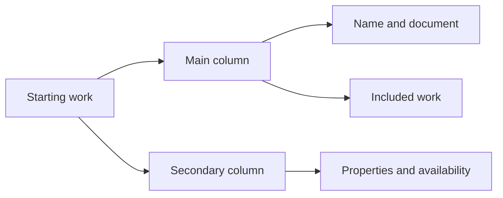

# Put the authored work first

This plan is for the engineer refining Docket authoring. The result must let a person read the starting document and included work without opening secondary settings. Willie approved this direction on October 24, 2026.

## Decision

Use a wider composition for Starting work and Review. The main column contains the work name, document, and actual included hierarchy. A 272px secondary column contains defaults. Phones keep one column with the work first. Purpose remains a short form rather than stretching its fields across the page.

Retain Purpose → Starting work → Included work → Review during creation and direct sections during editing. A populated Starting work section offers a direct Edit included work action. Creation may use this action only through the existing validation and reached-step rules. The Quarterly finances fixture remains verification data, not product content.

## Implementation

- [x] Widen the activity content and align its header, sections, and footer. Keep short Purpose content constrained.
- [x] Move properties and availability into a compact secondary column. Remove their full-width decorative disclosure surfaces. Keep actual optional controls reachable.
- [x] Show the actual included hierarchy below the document with an action to its existing editor. Preserve in-memory values and pending navigation protection.
- [x] Render the full starting document in Review, alongside the included hierarchy. Never invent example dates or claim that unresolved relative dates are scheduled.
- [x] Reduce repeated headings and clean saved-state text. Keep accessible status announcements and distinct template/work names.
- [x] Run behavior tests and package checks. Capture desktop, phone, both themes, 320px, empty work, populated work, and expanded controls through repository tooling. Inspect and correct the rendered composition.
- [x] Record final build evidence and commit the validated slice.

## Composition

This layout diagram shows the sections within Starting work.

## Boundaries and risks

No API, schema, recurrence, publication or versioning changes are needed. A larger editor must not introduce a second scroll owner. Included-work navigation must use the existing validation, selection and focus machinery. Long names and expanded settings must fit at 320px. Technical checks do not substitute for visual review.
